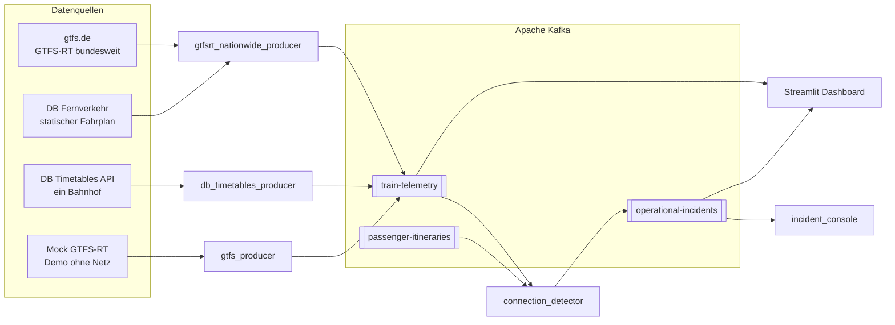

<div align="center">

# 🚆 Betriebsleitstelle Bahn

### Echtzeit-Überwachung von Verspätungen und gefährdeten Anschlüssen im deutschen Fernverkehr


<sub>MVP · Ereignisse &amp; Streaming · GTFS-RT × DB Timetables × Apache Kafka</sub>

</div>

---

> **Kurz gesagt:** Dieses System verbindet den bundesweiten GTFS-RT-Livestream mit dem Fernverkehrsfahrplan der DB, erkennt gefährdete Anschlüsse, **bevor** sie reißen, und priorisiert sie für die Betriebsleitstelle – in Echtzeit, mit Kafka und auch ganz ohne Broker.

## 🎯 Das Problem

Ein verpasster Anschluss ist selten nur ein verpasster Zug. Er löst eine Kette aus: Reisende stranden, Folgeleistungen geraten ins Rutschen, und das Betriebspersonal erfährt davon oft erst, wenn es bereits zu spät ist.

Die entscheidende Frage lautet nicht „Welcher Zug hat Verspätung?“, sondern:

> **Welcher Anschluss reißt in den nächsten Minuten – und wie viele Reisende sind betroffen?**

Fahrplan, Echtzeit-Telemetrie und Mindestumsteigezeit liegen normalerweise getrennt vor. Genau diese Lücke schließt das Projekt.

| Ohne dieses Projekt | Mit diesem Projekt |
| --- | --- |
| Verspätungen werden getrennt vom Fahrplan betrachtet | Telemetrie × Fahrplan × Umsteigezeit in einer Pipeline |
| Anschlussverluste fallen erst am Bahnsteig auf | Störung erscheint **vorab** in der Leitstelle |
| Alle Meldungen klingen gleich laut | **HOCH / MITTEL / NIEDRIG**, strikt priorisiert |
| Reisendenzahlen sind ein blindes „ungefähr“ | Schätzung als ehrlicher **Bereich** (35–65 %) |

## 💡 Die Lösung

1. **Einsammeln** – Zugtelemetrie aus GTFS-RT (bundesweit), der DB-Timetables-API oder einem lokalen Mock.
2. **Verknüpfen** – Jede Ankunft wird mit einer passenden Abfahrt am selben Bahnhof zu einem Anschluss kombiniert.
3. **Bewerten** – Der `connection_detector` vergleicht verfügbare und benötigte Umsteigezeit.
4. **Priorisieren** – Incidents werden als `HOCH`, `MITTEL` oder `NIEDRIG` veröffentlicht – mit empfohlener Maßnahme und geschätzter Reisendenzahl.

## 🏗️ Architektur



Im Modus `mock` bzw. `db` wird die linke Quelle durch den Mock-Server oder den DB-Produzenten ersetzt. Ohne erreichbaren Broker springt das Dashboard automatisch auf die **In-Process-Pipeline** um (`src/cloud_pipeline.py`) – dieselben Regeln, nur ohne Kafka als Transportweg.

## 🚉 Datenquellen

| Modus | Quelle | Abdeckung | Voraussetzung |
| --- | --- | --- | --- |
| `nationwide` *(empfohlen)* | `realtime.gtfs.de/realtime-free.pb` + statischer Fernverkehrsfahrplan (`fv`) | Fernverkehr in ganz Deutschland + teilnehmende Regionalbetreiber | keine Zugangsdaten |
| `db` | DB Timetables API (API Marketplace) | ein Bahnhof, standardmäßig Fulda (EVA `8000115`) | kostenloser DB-API-Account |
| `mock` | lokaler GTFS-RT-Server | reproduzierbares Demo-Szenario | keine |

> **Datenabdeckung, ehrlich gesagt:** Der nationale Echtzeit-Feed deckt den **Fernverkehr** und die Betreiber ab, die in `realtime.gtfs.de` veröffentlichen (z. B. VRR, VBB). Der übrige Nahverkehr ist dort nicht live enthalten – seine Fahrplandaten stecken aber in den statischen Feeds. Für Echtzeit einer Region müsste deren Feed angebunden werden.

### 🧠 Echte Zugnummern: `ICE 274` statt `ICE 25`

Der nationale GTFS-RT-Feed nennt oft nur die **Linie** (`ICE 25`), nicht die konkrete **Zugnummer** (`ICE 274`). Der `train_number_enricher` gleicht deshalb im Hintergrund die Fahrpläne der verkehrsstärksten Bahnhöfe über die DB-Timetables-API ab und ergänzt die echte Zugnummer, wo ein Treffer vorliegt. Die Linie bleibt immer erhalten.

<details>
<summary><strong>Feinabstimmung der Zugnummern-Anreicherung</strong></summary>

| Variable | Beschreibung | Standardwert |
| --- | --- | --- |
| `DB_ENRICH_ENABLED` | Aktiviert echte Zugnummern | `true` |
| `DB_ENRICH_MAX_STATIONS` | Anzahl der nach Verkehrsaufkommen abgefragten Bahnhöfe | `40` |
| `DB_ENRICH_PLAN_HOURS` | Fahrplanstunden je Bahnhof und Durchlauf | `2` |
| `DB_ENRICH_REFRESH_SECONDS` | Intervall des Hintergrunddurchlaufs | `180` |
| `DB_ENRICH_WORKERS` | Parallel abgefragte Bahnhöfe | `6` |
| `DB_ENRICH_MATCH_TOLERANCE` | Toleranz (s) beim Abgleich von Uhrzeit und Linie | `300` |

> Die Timetables-API arbeitet bahnhofsbezogen (Free-Tarif: 60 Anfragen/Minute). Nur abgefragte Bahnhöfe erhalten echte Zugnummern; mehr Bahnhöfe bedeuten mehr API-Aufrufe.

</details>

## ⚡ Kafka-Topics

| Topic | Inhalt | Fluss |
| --- | --- | --- |
| `train-telemetry` | `trip_id`, `train_number`, `station_id`, `delay_seconds`, geplante/geschätzte Ankunft, `timestamp` | Produzenten → Detektor & Dashboard |
| `passenger-itineraries` | Kohorte, Ausgangs- und Anschlusszug, Umsteigebahnhof, Mindestumsteigezeit, geschätzte Reisende inkl. Bereich | Produzent → Detektor |
| `operational-incidents` | Bahnhof, Züge, Schweregrad, empfohlene Maßnahme, betroffene Reisende, Defizit, Verspätung, `created_at` | Detektor → Konsole & Dashboard |

## 🖥️ Das Dashboard

Ein Streamlit-Panel im Look einer **Betriebsleitstelle** – dunkles Anthrazit, DB-Rot `#EC0016`, Barlow und IBM Plex Mono. Aktualisierung im Live-Betrieb alle 2 Sekunden.

| KPI | Bedeutung |
| --- | --- |
| **Überwachte Züge** | Züge im aktuellen Filter-Scope |
| **Züge mit Verspätung** | alles über der Pünktlichkeitsschwelle |
| **Pünktlichkeit** | Anteil pünktlicher Züge |
| **Offene Störungen** | noch nicht bearbeitete Incidents |
| **Betroffene Reisende (est.)** | Summe der geschätzten Spanne |

Dazu:

- 🚨 **Priorisierte Störungen** – strikt nach Schweregrad sortiert, mit empfohlener Maßnahme.
- 🗺️ **Filter nach Bundesland und Stadt** – der Knotenpunkt lässt sich isolieren.
- 🛠️ **Störungsmanagement** – einzelne oder alle Incidents als bearbeitet markieren.
- 🚆 **Status aller Züge** – farblich codierte Verspätung und betroffene Reisende.
- 🖥️ **ANSI-Konsole** (`incident_console`) – dieselbe Priorisierung fürs Terminal.

## ⚖️ Schweregrad-Logik

Das **Defizit** ist die fehlende Zeit, um den Anschluss zu garantieren: `benötigte Minuten − verfügbare Minuten`. Es ist das Hauptkriterium; die Verspätung des Ausgangszugs verstärkt das Urteil.

| Schweregrad | Kriterium | Empfohlene Maßnahme |
| --- | --- | --- |
| 🔴 **HOCH** | Defizit ≥ 10 min **oder** Verspätung ≥ 20 min | Anschluss halten / Bahnhof informieren und Gleis neu zuweisen |
| 🟠 **MITTEL** | Defizit ≥ 5 min **oder** Verspätung ≥ 10 min | Bahnhof informieren und schnellen Umstieg vorbereiten |
| 🟢 **NIEDRIG** | sonst | Reisende informieren und beobachten |

Die Regeln liegen bewusst in `src/business_rules.py` – **UI-frei** und damit auch von Konsole, Dashboard und Tests nutzbar.

## 🚀 Schnellstart

### Windows – ein Doppelklick

1. **`start.bat`** ausführen: Docker Desktop und Kafka starten, Python-Umgebung einrichten, alle Prozesse hochfahren und das Dashboard im Browser öffnen.
2. **`stop.bat`** beendet alles wieder.

### Linux / macOS / WSL / Git Bash

```bash
chmod +x run.sh && ./run.sh
```

Das Skript richtet die virtuelle Umgebung ein, startet Kafka im KRaft-Modus, wartet auf Port `9092`, startet die Datenquelle, den Detektor, die Konsole und das Dashboard.

### Danach

```text
http://localhost:8501
```

### Ohne Kafka starten

```bash
pip install -r requirements.txt
streamlit run streamlit_app.py
```

Im Modus `auto` erkennt das Dashboard, dass kein Broker erreichbar ist, und rechnet direkt mit dem GTFS-RT-Feed weiter.

## ⚙️ Konfiguration

Kopiere `.env.example` nach `.env`. Die Datei steht in `.gitignore` und gehört **nicht** ins Repository.

| Variable | Beschreibung | Standardwert |
| --- | --- | --- |
| `DATA_SOURCE` | `nationwide`, `db` oder `mock` | `nationwide` (empfohlen) |
| `DASHBOARD_MODE` | `auto`, `cloud` oder `kafka` | `auto` |
| `KAFKA_BOOTSTRAP_SERVERS` | Kafka-Broker | `localhost:9092` |
| `NATIONWIDE_REFRESH_SECONDS` | Abfrageintervall des nationalen Streams | `60` |
| `NATIONWIDE_HORIZON_MINUTES` | Vorausschau-Fenster | `90` |
| `NATIONWIDE_MAX_STATIONS` | maximale Bahnhöfe je Zyklus | `300` |
| `DB_CLIENT_ID` / `DB_API_KEY` | Zugangsdaten des API Marketplace (nur `db`) | – |
| `DB_STATION_EVA` | EVA des überwachten Bahnhofs (nur `db`) | `8000115` (Fulda) |
| `DB_REFRESH_SECONDS` | Abfrageintervall (nur `db`) | `30` |
| `MIN_TRANSFER_TIME_MINUTES` | Mindestumsteigezeit | `7` |
| `MAX_CONNECTION_WINDOW_MINUTES` | maximales Zeitfenster für Anschlüsse | `45` |
| `DASHBOARD_TABLE_ROW_LIMIT` | maximale Zeilen in Dashboard-Tabellen | `300` |

### DB-API-Zugang einrichten (nur `DATA_SOURCE=db`)

1. Konto auf [developers.deutschebahn.com](https://developers.deutschebahn.com) anlegen und eine *Application* erstellen.
2. Die **Timetables**-API im **Free**-Tarif abonnieren (60 Aufrufe/Minute, CC BY 4.0).
3. `DB_CLIENT_ID` und `DB_API_KEY` in `.env` eintragen.

## ☁️ Bereitstellung auf Streamlit Community Cloud

In der Cloud gibt es keinen Kafka-Broker – das Dashboard führt die Pipeline deshalb **im eigenen Prozess** aus. Dasselbe gilt lokal, wenn kein Broker erreichbar ist.

```text
GTFS-RT (bundesweit) + statischer Fernverkehrsfahrplan
    → Telemetrie + synthetisierte Anschlüsse
    → ConnectionDetector (identische Geschäftsregeln)
    → Incidents → LiveStore → Dashboard
```

| `DASHBOARD_MODE` | Verhalten |
| --- | --- |
| `auto` *(Standard)* | Kafka, wenn erreichbar – sonst In-Process |
| `cloud` | immer In-Process, ohne Broker |
| `kafka` | immer die Kafka-Topics |

**Schritte**

1. Repository auf GitHub veröffentlichen und auf [share.streamlit.io](https://share.streamlit.io) eine App anlegen.
2. **Main file path:** `streamlit_app.py` (Wrapper auf `src/dashboard_app.py`).
3. Optional unter **Settings → Secrets** echte Zugnummern aktivieren:

   ```toml
   DB_CLIENT_ID = "deine-client-id"
   DB_API_KEY = "dein-client-secret"
   ```

   Die Schlüssel stehen auf der **obersten Ebene**, ohne `[section]`.

4. Optional `DASHBOARD_MODE = "cloud"` setzen, um den Betrieb ohne Broker zu erzwingen.

> Die GTFS-RT-Feeds werden zur Laufzeit geladen und in `data/` gecacht. Ohne DB-Zugangsdaten läuft die App weiterhin – nur ohne echte Zugnummern.

## 🎬 Demo-Szenario

| Reisende | Anschluss | Lage | Ergebnis |
| --- | --- | --- | --- |
| `USR-101` | **ICE 593** → **ICE 590** | 15–20 min Verspätung, ca. **−8 min** verfügbar (Minimum: 7) | 🔴 **HOCH** |
| `USR-102` | **ICE 591** → **ICE 592** | pünktlich, ca. **30 min** verfügbar | ✅ keine Störung |

## 📁 Projektstruktur

```text
train-missed-connection-mvp/
├── start.bat / stop.bat            # Windows: Start und Stopp per Doppelklick
├── run.sh                          # Linux / macOS / WSL / Git Bash
├── streamlit_app.py                # Einstiegspunkt für Streamlit Cloud
├── docker-compose.yml              # Kafka im KRaft-Modus
├── .streamlit/config.toml          # DB-/ICE-Farbschema und Typografie
├── requirements.txt
└── src/
    ├── config.py                   # Umgebung, Topics, Schwellenwerte
    ├── business_rules.py           # reine Schweregrad-Logik
    ├── dashboard_app.py            # Betriebsleitstellen-Oberfläche
    ├── cloud_pipeline.py           # In-Process-Pipeline ohne Kafka
    ├── gtfs_schedule.py            # statischer Fernverkehrsfahrplan
    ├── gtfs_regional.py            # regionale Fahrplandaten
    ├── train_number_enricher.py    # echte Zugnummern über die DB-API
    ├── traveler_estimate.py        # Reisendenschätzung als Bereich
    ├── db_stations_client.py       # DB Stations API
    ├── db_timetables_client.py     # DB Timetables API
    ├── producers/                  # GTFS-RT, DB, Mock → Kafka
    ├── processors/                 # connection_detector (erkennt Anschlussrisiken)
    └── consumers/                  # incident_console
```

## 🛡️ Alarmmüdigkeit vermeiden

Ein Leitstand, der bei jedem Telemetrie-Tick aufschreit, wird ignoriert. Deshalb:

- **Cooldown** pro `(Bahnhof, Ausgangszug, Anschlusszug)` – keine Duplikate im Sekundentakt.
- **Strikte Sortierung** nach Schweregrad statt Eingangsreihenfolge.
- **Speicherlimits** für Telemetrie und Incidents im Dashboard.
- **Ein-Klick-Erledigung** – bearbeitete Störungen verschwinden aus dem Fokus.

## ⚠️ Grenzen & Ehrlichkeit

- Der nationale Echtzeit-Feed deckt **Fernverkehr** und teilnehmende Regionalbetreiber ab, nicht den gesamten Nahverkehr.
- Reale Reiseketten sind in den Quellen nicht enthalten. Anschlüsse werden aus dem Fahrplan **synthetisiert**.
- Reisendenzahlen sind **Schätzungen als Bereich** (35–65 % der typischen Kapazität), kein Fahrgastzählwert.
- Empfohlene Maßnahmen sind **Texthinweise** und lösen keine echten betrieblichen Vorgänge aus.
- Echte Zugnummern erscheinen nur an den Bahnhöfen, die die Anreicherung abfragt.

## 📜 Daten & Attribution

- Echtzeit- und Fahrplandaten: [gtfs.de](https://gtfs.de) – es gelten die Bedingungen der jeweiligen Feeds.
- DB Timetables API: **© DB Station&Service AG**, Lizenz **CC BY 4.0**.
- Alle Zug-, Bahnhofs- und Reisendendaten in diesem Repository dienen der Demonstration.

## 🤝 Mitmachen

Issues und Pull Requests sind willkommen. Für größere Änderungen bitte zuerst ein Issue öffnen, damit wir die Fahrtrichtung abstimmen.

<div align="center">

**Gute Fahrt!** 🚆

<sub>Gebaut mit Python, Streamlit, Kafka und einer gesunden Portion Fernverkehrsromantik.</sub>

</div>
